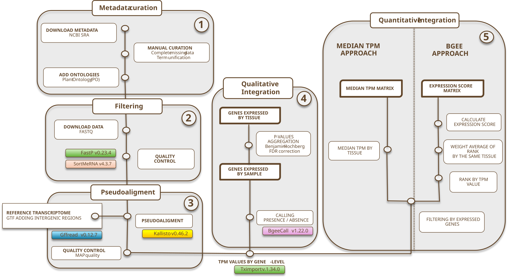

# Pipeline Overview

This folder contains a Snakemake workflow for RNA-seq quantification.

## Table of contents

- [Workflow](#workflow)
- [RNA quantification workflow](#rna-quantification-workflow)
  - [Inputs](#inputs)
  - [Outputs](#outputs)
  - [Run](#run)
  - [Notes](#notes)
  - [Post-processing: filtering and integration](#post-processing-filtering-and-integration)
  - [Metadata fields](#metadata-fields)


## Workflow



The pipeline follows two main steps:
1. Pre-procesing: 
    1.1 Obtain metadata 

    > *Advise* : Use ´create_sample_info()' from [bears package](https://github.com/almeidasilvaf/bears)

    1.2 Creation of a transcriptome FASTA and GTF annotation with intergenic regions, and a Kallisto index.
      > Inside Step 3 
2. [Snakemake workflow](#rna-quantification-workflow)
      > Step 2 and Step 3

      2.1. **Fastp** trims and quality-filters the raw FASTQ files.

      2.2. **SortMeRNA** removes rRNA reads using the 18S and 28S references.

      2.3. **Kallisto** quantifies the filtered reads against the prepared transcript index.

      2.4. **[Filtering by pseudoalignment rate](#post-processing-filtering-and-integration)** removes the samples with a low Kallisto pseudoalignment rate.

      2.5. **[Integration](#post-processing-filtering-and-integration)** of all the remaining samples into a gene-level expression atlas and expression score matrices.

      > Snakemake connects these steps automatically, so each sample moves through the workflow based on the files produced by the previous rule.
      > Step 4 and Step 5. 

### Snakemake workflow
#### Inputs

- A metadata table with sample information, columns required: `external_id_sample` (Run, use to download the raw files), `Layout`, `tissue_name`, `development_stage`, `BioSample` (use to collapse technical replicates and group samples)
> *Recommendation*: Curate metadata table beforehand.
- Reference files and a Kallisto index paths defined in `config/config.yaml`

> *Advise* 
>
> - To obtain GTF annotation with intergenic regions we used `pipeline/preprocessing/intergenic_gtf_creation.R`
>
> - To obtain transcriptome FASTA `gffread -w <transcriptome_fasta> -g <genome_fasta> <gtf_annotation_with_intergenics>`
>
> - To obtain kallisto index `kallisto index -i <output_index> <transcriptome_fasta>`

#### Outputs

- Fastp QC reports
- Kallisto quantification results
- Summary reports of pseudoaligment
- Presence/absence calling and expression score matrices ([post-processing](#post-processing-filtering-and-integration))

#### Run

Update the paths in `config/config.yaml` and then run Snakemake from this directory.

```bash
snakemake --rerun-incomplete --cores 1 --cluster-config cluster.yaml --cluster "sbatch -p {cluster.partition} -t {cluster.time} --mem {cluster.mem} --cpus-per-task {cluster.cpus} -o {cluster.output} -e {cluster.error}" --jobs 4 
```

#### Notes

- The workflow supports paired-end samples.
- Batch size and other options can be controlled from the configuration file.

#### Post-processing: filtering and integration

After the quantification, the `post_processing` target of the same Snakefile
filters the samples and integrates them into a gene-level expression atlas and
expression score matrices. It has two rules
([post-processing.smk](snakemake_pipeline/rules/post-processing.smk)):

1. `filter_by_pseudoalignment` keeps only the BioSamples whose Kallisto
   pseudoalignment rate (`p_pseudoaligned` in `run_info.json`) is at least
   `min_pseudoalign_pct`.
2. `integration` runs
   [integration_pipeline_v2.R](snakemake_pipeline/scripts/integration_pipeline_v2.R) on the
   filtered metadata: it aggregates the Kallisto estimates to gene level
   (using tximport), calls presence/absence with [BgeeCall](https://github.com/BgeeDB/BgeeCall) and builds the expression
   atlas and expression score matrices.


#### Parameters

Set in `config.yaml`:

- `transcriptome_fasta` / `annotation_gtf`: the transcriptome FASTA and matching
  GTF annotation used to build the Kallisto index. The transcript-to-gene map is
  derived automatically from the GTF at runtime - no separate precomputed file is
  needed.
- `species_id`: NCBI Taxonomy ID for the species (passed to BgeeCall).
- `min_pseudoalign_pct`: minimum pseudoalignment rate (%) to keep a BioSample
  (default `80`).

The metadata and the Kallisto output directory are the ones already defined in
`config.yaml` (`metadata`, `base_dir`).

##### Outputs

Under `<base_dir>/results/post_processing/`:

- `integration/`
  - `tpm_gene.rds`, `counts_gene.rds` - gene-level TPM and counts matrices.
  - `presence_absence_df.rds` - per-sample, per-gene presence/absence calls.
  - `presence_by_tissue.rds`, `presence_by_dev.rds` - expression atlas grouped
    by tissue, and by tissue x developmental stage.
  - `ExpressionScoreByTissue.rds`, `ExpressionScoreByDev.rds` - expression score
    matrices (0-100) per gene and condition.

### Metadata fields

Full column reference for the metadata table. 
Columns actually read by the pipeline code are marked *(used)*.

| Column | Meaning |
| --- | --- |
| `external_id_sample` | *(used)* Run accession in SRA/NCBI. Sample identifier matching the FASTQ files. |
| `IDBiologicalSampleFruitDBase` | *(used)* Like BioSample in SRA/NCBI. Biological sample identifier; runs that share this value are technical replicates of the same biological sample, and the integration script keeps only the one with the most processed reads. |
| `developmental_stage` | *(used)* Developmental stage of the sample. |
| `origin_country` | Country where the biological material was collected or grown. |
| `origin_city` | City/locality where the biological material was collected or grown. |
| `url` | Download URL for the raw sequencing data. |
| `project_title` | Title of the FruitDBase project the sample was curated under. |
| `origin` | Free-text description of the biological origin of the sample (e.g. cultivar, orchard, collection site). |
| `BioSample` | NCBI BioSample accession. |
| `Experiment` | SRA Experiment accession (SRX). |
| `tissue_name` | *(used)* Tissue/organ label. Groups samples for the expression atlas and expression score "by tissue". |
| `Pubmed` | PubMed ID of the associated publication, if any. |
| `external_id` | Bioproject in SRA NCBI / ID of samples' project |
| `Instrument` | Sequencing instrument model. |
| `Layout` | *(used)* Sequencing layout: `SINGLE` or `PAIRED`. |
| `Selection_method` | Library selection method (e.g. cDNA, RANDOM, PCR). |
| `SRA_sample` | SRA Sample accession (SRS). |
| `SRA_study` | SRA Study accession. |
| `treatment` | Experimental treatment applied to the sample, if any. |
| `accession_name` | Name of the cultivar/accession/variety. |
| `Study_abstract` | Abstract text of the associated study. |
| `project_title` | Title of the BioProject in NCBI SRA . |
| `Date` | Sample collection or submission date. |
